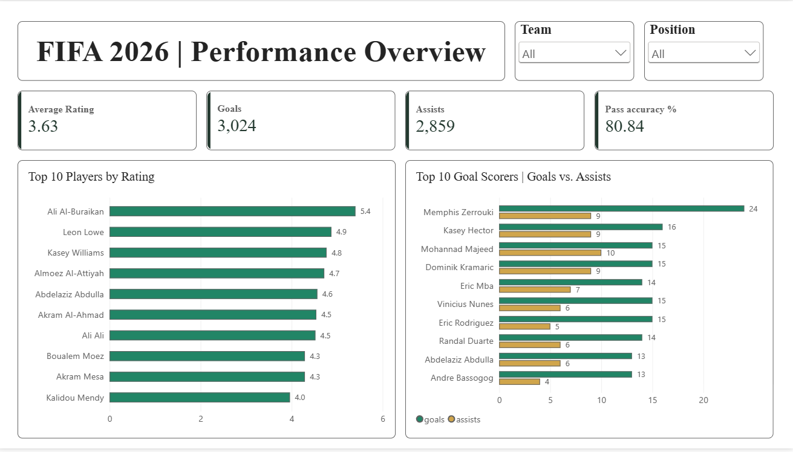
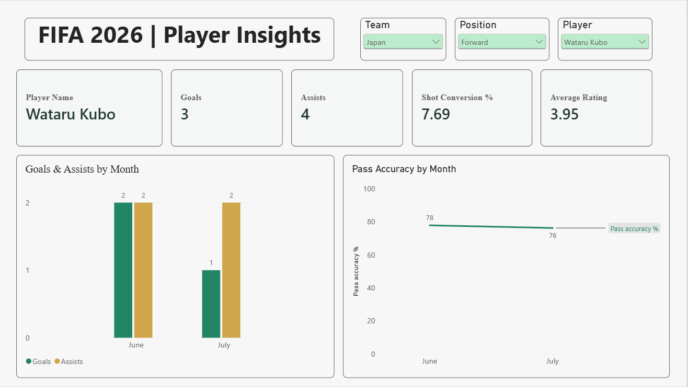

# FIFA 2026 | Football Performance Analysis

An interactive Power BI portfolio project exploring football performance across teams, positions, players and months using DAX and data visualization.

## Project objectives

- Compare team and player performance using goals, assists, ratings and passing accuracy.
- Identify leading players and goal scorers.
- Explore individual player performance and monthly trends through interactive filters.

## Dashboard 1 — Performance Overview



Team and position slicers enable comparative analysis. KPI cards summarize average rating, goals, assists and passing accuracy. Horizontal bar charts compare the top 10 players by rating and leading goal scorers alongside assists.

### Key observations from the overview screenshot

| KPI | Value |
| --- | ---: |
| Average rating | 3.63 |
| Goals | 3,024 |
| Assists | 2,859 |
| Average pass accuracy | 80.84% |

Memphis Zerrouki leads the displayed goal scorers with 24 goals. Ali Al-Buraikan leads the displayed rating chart with 5.4.

## Dashboard 2 — Player Insights



Team, position and player slicers support individual performance analysis. KPI cards display player name, goals, assists, shot conversion and average rating. Monthly charts compare goals and assists and show passing accuracy trends.

Example selection: Wataru Kubo, Japan, Forward.

| KPI | Value |
| --- | ---: |
| Goals | 3 |
| Assists | 4 |
| Shot conversion | 7.69% |
| Average rating | 3.95 |

Passing accuracy changes from approximately 78% in June to 76% in July, while assists remain at two per month.

## Tools and techniques

- Microsoft Power BI Desktop
- DAX measures and aggregations
- Interactive slicers and filter context
- KPI cards, bar charts, column charts and line charts
- Dashboard design and exploratory analysis

## DAX measures

```dax
Average Rating = AVERAGE(fifa_world_cup_2026_player_performance[player_rating])

Pass accuracy % = AVERAGE(fifa_world_cup_2026_player_performance[pass_accuracy]) * 100
```

Shot conversion represents goals divided by shots, expressed as a percentage. Pass accuracy is an unweighted average of recorded accuracy values.

## Open the report

1. [Download the Power BI report](https://github.com/LightYXP/fifa-2026-power-bi-analysis/raw/refs/heads/main/FBDV.pbix).
2. Open the file in Microsoft Power BI Desktop.
3. Explore the Performance Overview and Player Insights pages using the slicers.

## Data and limitations

This is an exploratory portfolio project. The displayed results describe the supplied dataset and have not been verified against official FIFA tournament statistics. Dataset provenance and redistribution permissions remain unverified. Full report execution and the final Top N filter and player slicer behavior have not been independently validated.

## Author

[LightYXP](https://github.com/LightYXP)
